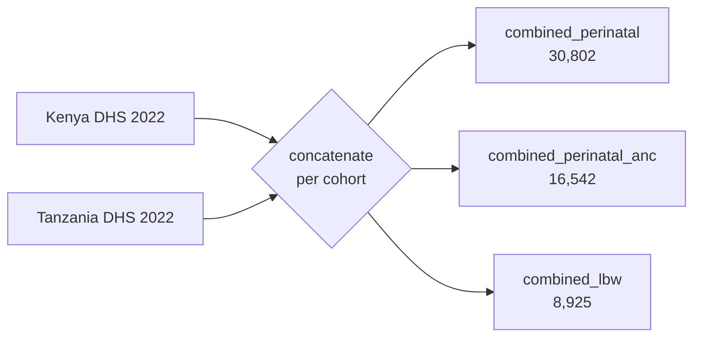

# Kenya vs Tanzania — how the two datasets compare

We **pool** Kenya and Tanzania into one combined dataset per cohort, then split
80/20. Pooling only makes sense because the two are similar in structure — but
they are not identical, and the differences matter for interpreting the model.
This page lays the two side by side.

## How the data is pooled

## Cohort sizes and outcome rates

| Cohort | Country | Rows | Events | Rate |
|---|---|---|---|---|
| perinatal | Kenya | 19,822 | 677 | 3.42% |
| perinatal | Tanzania | 10,980 | 412 | 3.75% |
| perinatal + ANC | Kenya | 10,590 | 315 | 2.97% |
| perinatal + ANC | Tanzania | 5,952 | 205 | 3.44% |
| low birth weight | Kenya | 4,299 | 356 | 8.28% |
| low birth weight | Tanzania | 4,626 | 355 | 7.67% |

**Read it as:** Kenya contributes roughly **twice** the perinatal rows. Perinatal
death is a little **more common in Tanzania**; low birth weight is a little
**more common in Kenya**.

## Who the mothers are (perinatal cohort)

| Feature | Kenya | Tanzania |
|---|---|---|
| Mean age | 26.7 | 27.1 |
| Rural | 66% | 73% |
| Told high blood pressure | 7.5% | 6.0% |
| Multiple pregnancy | 3.3% | 3.3% |
| Previous stillbirth | 3.2% | 4.1% |

**Read it as:** Tanzania's sample is **more rural** and reports **more previous
stillbirths**; Kenya reports **more high blood pressure**. Multiple-pregnancy
rates match.

## Outcome rate, side by side

```mermaid
xychart-beta
  title "Perinatal death rate (%)"
  x-axis ["perinatal", "perinatal+ANC", "lbw (×0.1)"]
  y-axis "rate %" 0 --> 9
  bar "Kenya" [3.42, 2.97, 8.28]
  bar "Tanzania" [3.75, 3.44, 7.67]
```

## Why this matters for the model

- **Pooling is justified** — same questionnaire (DHS-8), same columns, similar
  rates. Stacking them gives more events to learn from.
- **Keep the `country` column** so the model (and the eval dashboard) can show
  whether risk behaves differently by country.
- **Watch the imbalance** — Kenya is ~64% of the perinatal rows, so the pooled
  model leans slightly toward Kenyan patterns. Worth a note in the report.

> Numbers are unweighted, computed from the processed cohorts. Weighted national
> rates differ slightly (see the proposal's stillbirth-rate check).
