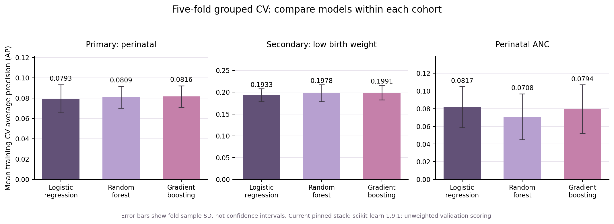

# Notebook audit — 17 November 2026

All 19 notebooks completed under the pinned current scikit-learn 1.9.1 stack. The 17 original research notebooks also completed under 1.5.2; the other two notebooks load 1.9.1 release artifacts. Each execution used a fresh kernel and an isolated copy of the same six processed CSVs. Network access and metric publication were disabled. Fitted serving releases were preserved.

Base source commit: `14d7c70`. Three execution/scoring repairs are included in this audit: portable Kenya EDA loading, restoring EDA-only pooled columns, and explicitly unweighted GB validation scoring. Numerical dependencies, source hashes, data hashes, five fold scores, parameters, split hashes, counts and execution status are in [the aggregate JSON report](notebook-results-2026-11-17.json). No individual records are included.

## The ANC discrepancy

The same ANC RF notebook gives test AP **0.088694** with sklearn **1.5.2**, and **0.091858** with **1.9.1**. The selected source/data/split are the same. This is a version effect, not rounding, and the larger value is reproducible on the current stack rather than proof of an older run. The earlier change from 1.5.2 to 1.9.1 in shared ML requirements affected notebook reproducibility.

Other forest results change as well. Perinatal RF gives 0.071677 / 130 caught in 1.5.2 versus 0.073058 / 124 caught in 1.9.1. LBW RF gives 0.129367 / 74 caught in 1.5.2 versus 0.137016 / 79 caught in 1.9.1. The proposed sensitivity summary therefore combines different environments.

Perinatal GB passed balanced fitting sample weights to GridSearchCV. Under 1.9.1, automatic forwarding also weighted compatible validation scorers, producing CV AP **0.653123**, which was not comparable with the unweighted scores near 0.08. Explicit routing now weights fitting only and leaves validation AP/ROC-AUC unweighted. The corrected notebook was rerun successfully in both versions. No feature or training-weight definition changed.

## Current pinned stack: sklearn 1.9.1

CV is the evaluation procedure; AP/PR-AUC is the metric. The table uses the mean and sample SD across the five grouped training folds. SD describes fold variation and is not an independent-test confidence interval.

| Cohort | Algorithm | CV AP mean ± fold SD | Test AP | Test ROC-AUC | TP | FN | FP | TN | Recall | Checklist TP |
|---|---|---:|---:|---:|---:|---:|---:|---:|---:|---:|
| perinatal | Logistic regression | 0.0793 ± 0.0138 | 0.0723 | 0.5989 | 129 | 91 | 2679 | 3290 | 58.6% | 115 |
| perinatal | Random forest | 0.0809 ± 0.0106 | 0.0731 | 0.5998 | 124 | 96 | 2684 | 3285 | 56.4% | 115 |
| perinatal | Gradient boosting | 0.0816 ± 0.0105 | 0.0742 | 0.6064 | 130 | 90 | 2678 | 3291 | 59.1% | 115 |
| lbw | Logistic regression | 0.1933 ± 0.0147 | 0.1429 | 0.6127 | 76 | 54 | 694 | 1025 | 58.5% | 69 |
| lbw | Random forest | 0.1978 ± 0.0190 | 0.1370 | 0.6263 | 79 | 51 | 691 | 1028 | 60.8% | 69 |
| lbw | Gradient boosting | 0.1991 ± 0.0165 | 0.1590 | 0.6182 | 73 | 57 | 697 | 1022 | 56.2% | 69 |
| perinatal_anc | Logistic regression | 0.0817 ± 0.0233 | 0.0849 | 0.6324 | 66 | 42 | 1391 | 1811 | 61.1% | 49 |
| perinatal_anc | Random forest | 0.0708 ± 0.0260 | 0.0919 | 0.6313 | 70 | 38 | 1387 | 1815 | 64.8% | 49 |
| perinatal_anc | Gradient boosting | 0.0794 ± 0.0274 | 0.0786 | 0.6218 | 63 | 45 | 1394 | 1808 | 58.3% | 49 |

All nine models catch more affected test cases than the checklist at the same flag count. Perinatal uses 6,189 test records / 220 events and flags 2,808; ANC uses 3,310 / 108 and flags 1,457; LBW uses 1,849 / 130 and flags 770.

The perinatal RF stable tie rule catches 124, with 124–133 possible depending on tie allocation. Perinatal GB catches 130, with 127–130 possible. These ranges arise from tied scores at the screening boundary; they are not confidence intervals or variation across five CV runs. Exact tie metadata for every row is in the JSON report.

## Selection recommendation

For the original research experiment, use mean **training CV AP** for model selection and reserve held-out test metrics for reporting. Strict maximum mean CV AP selects GB for perinatal, GB for LBW, and LR for ANC.

Choosing **perinatal LR, LBW GB, ANC LR** is defensible when perinatal LR is explicitly a parsimony choice among close CV scores. Its CV AP is 0.0793 versus RF 0.0809 and GB 0.0816: do not call LR the highest numerical scorer or claim statistical equivalence. LBW GB and ANC LR have the highest CV means on this current stack; their margins should still be reported with fold variation.

If the primary objective is finding the most affected cases at a fixed review workload, evaluate that rule using training/validation folds and choose a CV sensitivity-at-capacity objective. Highest CV AP does not guarantee highest sensitivity at one capacity: LBW RF catches 79 test cases while GB catches 73. Do not choose a model retrospectively by switching between test AP and test recall. The ANC notebook’s ordinary CV recall scorer uses the default classification threshold and is not the same measure as equal-capacity screening recall.

These tuning CV estimates reuse folds to choose hyperparameters; they are not five independent external validations. The test set has already been examined repeatedly during the project, so a new selection rule cannot make it newly untouched. Fix the selection/threshold rule before further evaluation; independent validation remains necessary for clinical use.

## Original-version reproduction: sklearn 1.5.2

| Cohort | Algorithm | CV AP | Test AP | Caught / actual events |
|---|---|---:|---:|---:|
| perinatal | Logistic regression | 0.0793 | 0.0723 | 129 / 220 |
| perinatal | Random forest | 0.0772 | 0.0717 | 130 / 220 |
| perinatal | Gradient boosting | 0.0816 | 0.0742 | 130 / 220 |
| lbw | Logistic regression | 0.1933 | 0.1429 | 76 / 130 |
| lbw | Random forest | 0.2014 | 0.1294 | 74 / 130 |
| lbw | Gradient boosting | 0.1991 | 0.1590 | 73 / 130 |
| perinatal_anc | Logistic regression | 0.0817 | 0.0849 | 66 / 108 |
| perinatal_anc | Random forest | 0.0682 | 0.0887 | 66 / 108 |
| perinatal_anc | Gradient boosting | 0.0794 | 0.0786 | 63 / 108 |

Under 1.5.2 the strict CV winners differ: perinatal GB, LBW RF and ANC LR. Do not retain only the most favorable rows from each library version. Use `ml/requirements-notebooks.txt` for the current supported comparison and `ml/requirements-research-legacy.txt` only for the older-version reproduction.

## UI and deployment

The existing Notebook submissions view ranks saved test AP from the database; it does not yet persist CV scores, source/version provenance or a full selection rationale. The numbers quoted in the request (perinatal RF ≈0.0731, LBW GB ≈0.1590 and ANC RF ≈0.0919) match the current-stack notebook test values to the displayed rounding. ANC ≈0.0887 is the older-library reproduction. No fresh live database read was available during this audit; these UI references are the supplied values and the earlier verified submissions.

The API model releases view describes separate fitted antenatal-history releases, which have different available inputs and calibration. Choosing an algorithm for these original research notebooks does not by itself replace the clinician model files. No metric rows or model release packages were published by this audit.

Executed copies are retained locally under ignored `ml/notebook-runs/2026-11-17/`. They can contain licensed survey rows and must remain private. Checked-in notebooks have their saved outputs cleared when edited.

Sources: [scikit-learn cross-validation guidance](https://scikit-learn.org/stable/modules/cross_validation.html), [nested versus non-nested CV](https://scikit-learn.org/stable/auto_examples/model_selection/plot_nested_cross_validation_iris.html), [GridSearchCV fitting/scoring metadata](https://scikit-learn.org/stable/modules/generated/sklearn.model_selection.GridSearchCV.html), [decision-threshold guidance](https://scikit-learn.org/stable/modules/classification_threshold.html).
